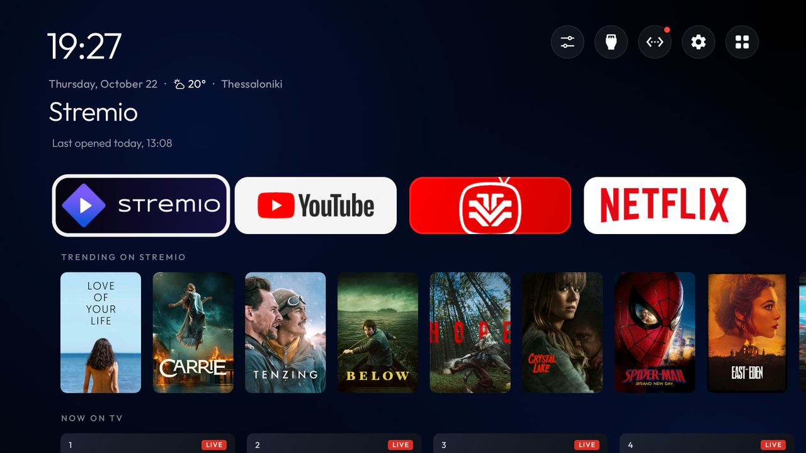
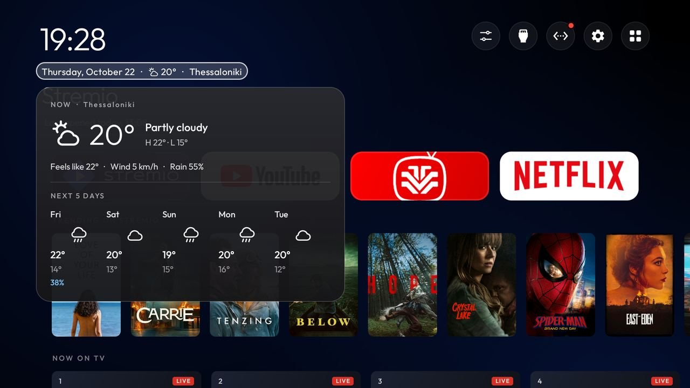
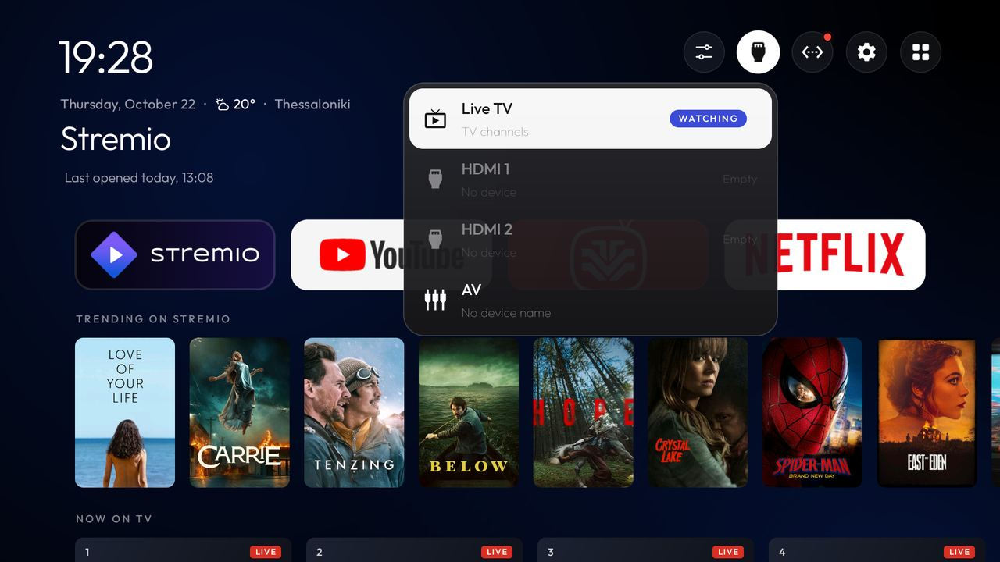
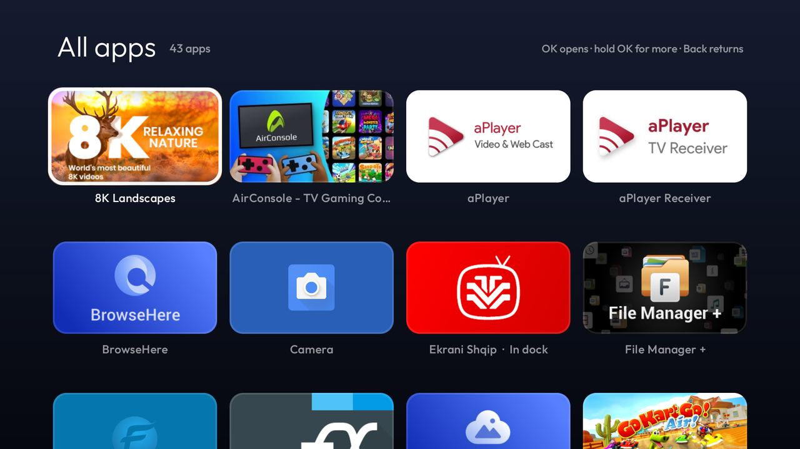
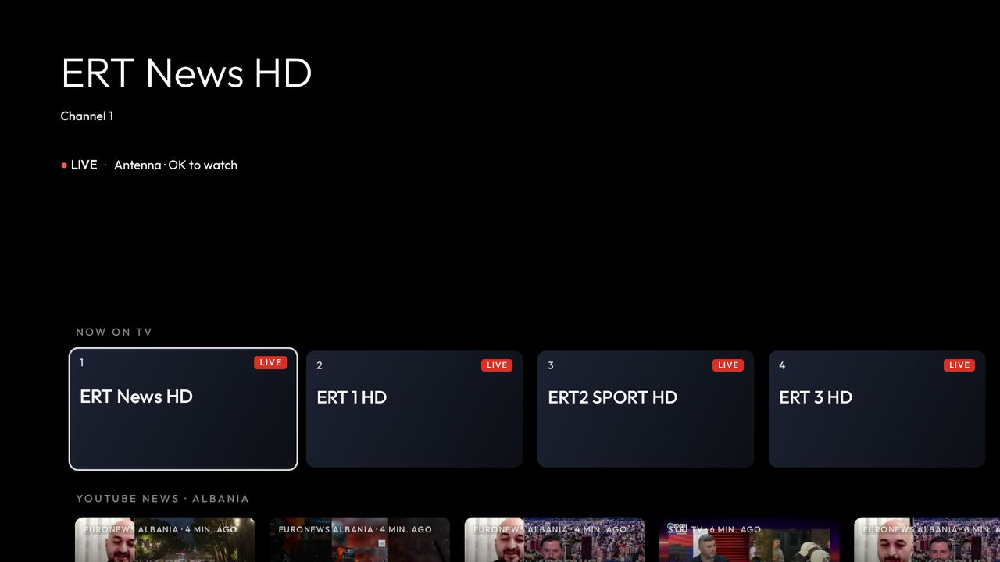

# Minimal Home: a calmer home screen for the cleanyourtv launcher

This fork keeps everything in [cleanyourtv](https://github.com/Gathin23/cleanyourtv) (the debloat
scripts, the restore, the launcher and its themes) and gives the launcher a second look: **Minimal Home**.
It has a thin clock, one line with the date and weather, round icon buttons, a dock of four app banners,
and content rows under it.

Built and used daily on a **TCL Smart TV Pro (BeyondTV4, MediaTek, Android TV 11, 2 GB)**. It has not
been run on any other TV yet; reports are welcome.



| | |
|---|---|
|  |  |
|  |  |

## What it adds

- **Filled dock tiles.** Each app shows its TV banner, cropped to fill the tile. An app without one gets
  its icon, large, on a tile in the icon's main colour.
- **Content rows under the dock**, each with its own switch in Launcher settings:
  - **Stremio**: Continue watching (only with the Stremio login on the TV, set over adb and kept only on
    the TV) and Trending. Focusing a card fills the top of the screen with its backdrop (about 1280 px,
    loaded after the focus rests for 400 ms), title, description and rating.
  - **Now on TV**: the TV's own antenna channels, read from the system TV provider (no internet). OK
    switches to that channel in the TV's Live TV app. Where the provider has a guide, a card shows the
    programme, its times, a progress bar and what is next. TCL keeps its guide inside its own TV app, so
    on TCL sets the cards show the channel only.
  - **News**: the latest videos from news channels on YouTube, or web headlines, for a chosen country.
- **Weather** in the date line (Open-Meteo). Left from the first round button focuses it, and OK opens a
  panel with now (temperature, condition, feels like, wind, rain chance, high and low) and the next 5
  days. Any button closes it. Pick the place in Launcher settings: type a city or town, then choose it
  from the places Open-Meteo finds.
- **Five round buttons**: Control center (sleep timer, free memory, sound output, screensaver, clock and turn off), Inputs,
  Network, Settings and **All apps**.
- **Inputs dropdown**: Live TV, each HDMI port and AV, with the device name the TV reports. A green dot
  marks a connected port, "Empty" a free one, and WATCHING the current input. OK on an empty port says
  "No signal" first instead of switching to a black screen.
- **All apps page**: every app A to Z on the same filled tiles. Hold OK on a tile to add it to the dock,
  hide it from Home, or open App info. "Apps per row" in Launcher settings sets this page.
- **Wallpaper**: the ambient glow, a photo from the TV or a USB drive, or a slideshow of the daily
  Bing and NASA pictures, with a darken setting.
- **Remote keys**: an `app_keys` entry can send an intent action (`"4001:action:com.tcl.tv.action.EPG"`),
  so a TCL TV button can open the program guide.

## Network and privacy

The classic launcher makes no network requests. Minimal Home uses the network for its rows and the
weather, and each of them can be switched off:

| Feature | Talks to |
|---|---|
| Weather and forecast | `api.open-meteo.com`, every 30 minutes at most; `geocoding-api.open-meteo.com` only while you search for a place |
| Stremio row | `v3-cinemeta.strem.io` for Trending; `api.strem.io` for Continue watching, only with a login stored on the TV |
| News row | YouTube channel feeds (`youtube.com/feeds`), or Google News or a few news sites' RSS feeds |
| Daily pictures | `bing.com` and `nasa.gov`, twice a day, only with the slideshow on |
| Pictures | `i.ytimg.com`, `images.metahub.space` (Stremio), and the hosts named in the feeds |

There are no accounts, ads, analytics or background services. Everything is fetched only while Home is
on screen.

## Turning it on and off

Minimal Home is on by default in this fork (`minimal_home` in `config.xml`, theme key `"minimal_home"`).
Set it to `false` for the classic Home. Right-to-left layouts (Hebrew) keep the classic Home. New
strings are in English only.

`build-and-install` grants two extra permissions over adb: `READ_TV_LISTINGS` for the Now on TV row and,
as before, location for the Wi-Fi name. The weather place can also be set from the computer:

```bash
adb shell am start -n com.gathin.tvhome/.MainActivity \
  -a com.gathin.tvhome.action.LAUNCHER_SETTINGS --es weather_place "Thessaloniki=40.6401,22.9444"
```

## Speed

On the TCL above, moving focus draws a frame in about 25 ms most of the time, with an occasional hitch
when a row loads; the launcher uses about 50 MB. On a weaker TV, switch off Advanced effects first, then
the movie hero, then rows you do not use.
